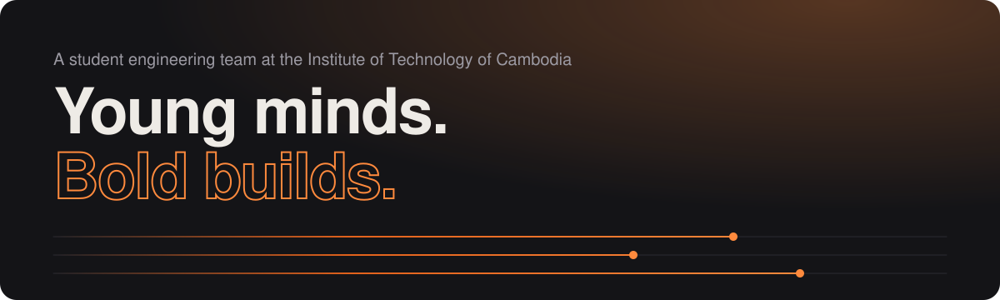
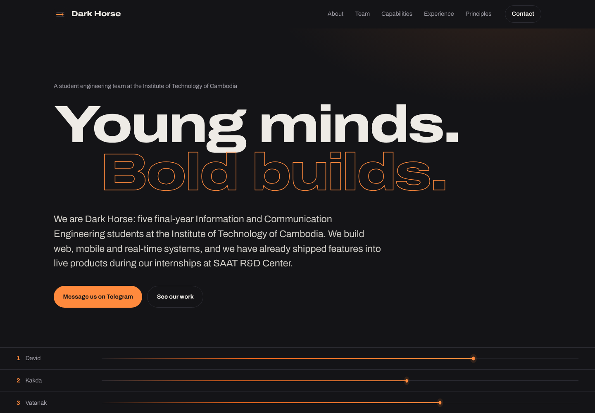

<div align="center">

<a href="https://chinghoir.github.io/dark_house/"></a>

<br>

<a href="https://chinghoir.github.io/dark_house/"></a>
&nbsp;
<a href="https://chinghoir.github.io/dark_house/km/"></a>
&nbsp;
<a href="https://t.me/bangseokh3ro"></a>
&nbsp;
<a href="https://gicitc.com/teams/18-dark-horse"></a>

<br><br>

**Five final-year Information and Communication Engineering students at the Institute of Technology of Cambodia,**<br>
**building web, mobile and real-time systems.**

<br>

| **5** Members | **9** Projects | **3** Industry projects | **6** Academic projects |
|:---:|:---:|:---:|:---:|

</div>

---

## About us

We have built software in real companies during our internships at **SAAT R&D Center** and in team projects at school, so we know the difference between a project that only works in a demo and a system that people use every day.

Our ICE training covers networks and infrastructure as well as software. We don't stop at writing code: we also understand how a system is hosted, secured and connected. Each member owns a clear part of the work, and all of us have a full-stack background, so we understand how the whole system fits together.

<div align="center">
<a href="https://chinghoir.github.io/dark_house/"></a>
<br>
<sub>Click the preview to open the website.</sub>
</div>

---

## Meet the team

<table align="center">
  <tr>
    <td align="center" width="20%"><br><b>CHORK RatanakDavid</b><br><sub>Team Lead · Full-Stack Developer</sub></td>
    <td align="center" width="20%"><br><b>CHHEANG Kakda</b><br><sub>Frontend Developer</sub></td>
    <td align="center" width="20%"><br><b>DAVIN Vatanak</b><br><sub>Backend Developer</sub></td>
    <td align="center" width="20%"><br><b>DIN Rasy</b><br><sub>Database & DevOps Engineer</sub></td>
    <td align="center" width="20%"><br><b>HUY Chanchhinghoir</b><br><sub>UI/UX Designer · QA · Mobile Developer</sub></td>
  </tr>
</table>

| Member | Main responsibility | Key skills |
|---|---|---|
| **David** | Leads the team, plans the project and builds across the full stack | NestJS, React, Next.js, PostgreSQL, WebSocket, Flutter |
| **Kakda** | Builds the screens and dashboards users see | Next.js, React, Admin Dashboards, Analytics |
| **Vatanak** | Builds the APIs, business logic and payment integration | NestJS, REST APIs, Payment Gateways, Supabase, Flutter |
| **Rasy** | Designs the database and handles servers and deployment | PostgreSQL, Database Design, Docker, CI/CD, Linux |
| **Chanchhinghoir** | Designs the user experience, tests quality and builds mobile | Figma, Testing, Flutter, Vue.js, Next.js |

---

## Experience

### Industry: SAAT R&D Center

| Project | What it does | Built by |
|---|---|---|
| **SaatMenu v2** | QR menu and ordering platform for restaurants with online payment | Kakda, Vatanak, Chanchhinghoir |
| **SmartBin Management System** | Smart waste monitoring with live fill levels, map, alerts and maintenance requests | David |
| **SAAT Water & SAAT Wash CMS** | Bilingual content management for two public websites | Rasy |

### Academic

| Project | What it does | Built by |
|---|---|---|
| **Gift Anusav** | Android and iOS app for ordering Cambodian handmade gifts, with map, quiz, booking and chat | David, Vatanak, Rasy |
| **[Farm-Link](https://github.com/ChingHoir/farmlink)** | Marketplace connecting farmers and buyers, with English/Khmer, cart and QR checkout | Chanchhinghoir |
| **Local Cam E-Commerce** | Online shop for local products with category filtering | Chanchhinghoir |
| **NearMe Social** | Location-based social app with nearby feed, real-time chat and admin reports | David |
| **Jomnus** | Task exchange platform with messaging, proof of completion and ratings | Rasy |
| **Library Management System** | Manages books, members and borrowing | Whole team |

---

## Technology

<p align="center">
  
</p>

---

<div align="center">

### Bet on the dark horse.

Have a project you want built properly, from the first sketch to a deployed system? Tell us about it.

<a href="https://chinghoir.github.io/dark_house/"></a>
&nbsp;
<a href="https://t.me/bangseokh3ro"></a>

</div>

---

<details>
<summary><b>For developers: how this website is built</b></summary>

<br>

The website is a static, dependency-free page served by GitHub Pages from the `docs/` folder.

```
src/
  data.js        English page content (members, projects, capabilities, copy)
  data.km.js     Khmer page content (same structure as data.js)
  components.js  Reusable render functions (Section, Lane, Capability, ...)
  page.js        Page layout built from the components
  assets/        CSS, JS, font and favicon (copied into docs/ on build)
build.js         Renders src/ into docs/index.html (English) and docs/km/index.html (Khmer)
docs/            Built site, served by GitHub Pages
```

**Edit content:** change `src/data.js` (English) and `src/data.km.js` (Khmer), run `npm run build` (Node 18+), then commit `src/` and `docs/` together. Preview locally with `npm start` and open http://localhost:4173.

**Publish:** Settings → Pages → Deploy from a branch → branch `main`, folder `/docs`.

**Notes:** member photos and the team logo load from gicitc.com, with initials as a fallback. Fonts: [Archivo](https://github.com/Omnibus-Type/Archivo) and [Noto Sans Khmer](https://fonts.google.com/noto/specimen/Noto+Sans+Khmer) (both SIL Open Font License), self-hosted. The ខ្មែរ / EN button in the header switches between the two pages. Motion respects the visitor's reduce-motion setting.

</details>
